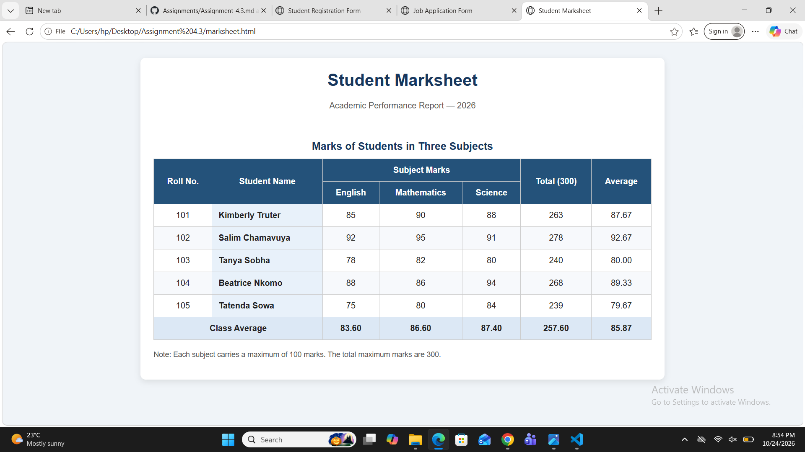

## Assignment 4.3 — Student Marks Table

### 1. Aim

To create a student marksheet table using HTML table elements to display students' marks in different subjects.

### 2. Theory

HTML tables are used to organize and display data in rows and columns. In this assignment, an HTML table was created to display the marks of at least five students in three subjects.

The `<table>` element defines the table, `<tr>` creates rows, `<th>` defines header cells, and `<td>` displays data cells. The `<thead>`, `<tbody>`, and `<tfoot>` elements organize the table into its header, body, and footer sections. The `<caption>` element provides a title for the table.

The `colspan` and `rowspan` attributes are used to merge cells across columns or rows when required. Meaningful table headers make the data easier to understand, while the footer displays the total or average marks.

### 3. Objectives

- To understand the structure of HTML tables.
- To display student marks in rows and columns.
- To use table headings and data cells correctly.
- To organize tables using `<thead>`, `<tbody>`, and `<tfoot>`.
- To use the `<caption>`, `colspan`, and `rowspan` attributes.
- To display total or average marks in the table footer.

### 4. Technologies Used

- HTML5: To create and structure the marksheet table.
- Web Browser: To display and test the table.

### 5. HTML Elements Used

- `<table>`: Defines the table.
- `<caption>`: Adds a title to the table.
- `<tr>`: Defines a table row.
- `<th>`: Defines a header cell.
- `<td>`: Defines a data cell.
- `<thead>`: Groups the header rows.
- `<tbody>`: Groups the main data rows.
- `<tfoot>`: Groups the footer rows.
- `colspan`: Merges multiple columns.
- `rowspan`: Merges multiple rows.

### 6. Procedure

1. Create an HTML file named `marksheet.html`.
2. Add a title to the student marksheet using the `<caption>` element.
3. Create table headings for student details and subjects.
4. Add marks for at least five students in three subjects.
5. Organize the table using `<thead>`, `<tbody>`, and `<tfoot>`.
6. Use `colspan` or `rowspan` where appropriate.
7. Calculate and display total or average marks in the footer.
8. Open the file in a web browser and verify the table.
9. Capture a screenshot of the complete marksheet for submission.

### 7. Result

A student marksheet table was created successfully using HTML table elements. It displays the marks of at least five students in three subjects and includes a caption, organized table sections, and total or average marks in the footer.

### 8. Conclusion

This assignment helped me understand how to create and organize tables in HTML. I learned to use table elements, group table sections, merge cells using `colspan` and `rowspan`, and display student marks in a structured and readable format. 
## RESULT

